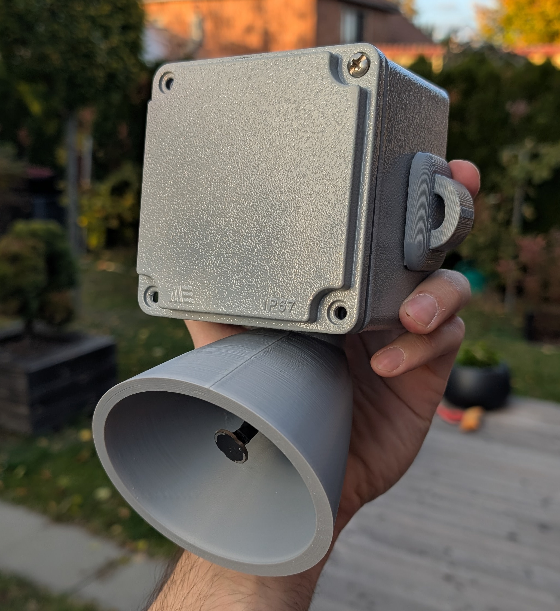
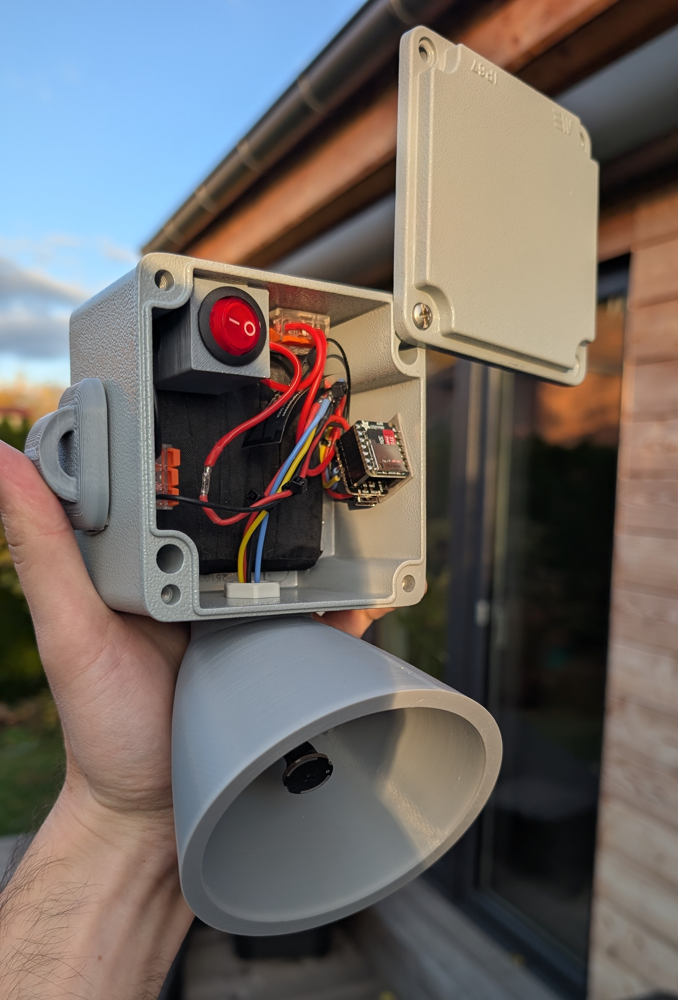

<p align="center">
  
</p>

<h1 align="center">BirdNETMic</h1>
<p align="center"><strong>Stream to BirdNET. Record to microSD. Control it from your browser.</strong></p>
<p align="center">
  <a href="https://esp32mic.msmeteo.cz">Web flasher</a> ·
  <a href="https://github.com/Sukecz/esp32-birdnet-mic/releases/latest">Published releases</a> ·
  <a href="esp32-birdnet-mic/CHANGELOG.md">Changelog</a>
</p>

Open-source ESP32 microphone firmware with two modes: **Streaming** sends live audio
to BirdNET-Go, BirdNET-Pi, VLC or ffmpeg; **Recording** saves WAV files to a microSD
card, even away from your home Wi-Fi. Use **Listen** for a quick sound check in either mode.
Bird identification runs on the receiving computer, not on the ESP32.

> **Firmware 2.03** — fixes Recording memory and Listen recovery, and adds a custom device Wi-Fi password.
> [Validation and hardware limits](release-notes/2.03-validation.md).

**[Boards](#supported-boards) · [Quick start](#quick-start) · [Modes](#streaming-and-recording) · [Battery](#battery) · [Features](#features) · [Wiring](#microphones-and-wiring) · [Help](#everyday-use-and-troubleshooting)**

## Start with the right hardware

**For a new build, choose XIAO ESP32-C5 + an IM73D122 PDM microphone.**
C5 offers PSRAM for audio/recording buffers and built-in battery voltage measurement,
so no external measurement divider is needed. Add the Adafruit microSD BFF #5683
for a standalone recorder. PDM is our preferred microphone choice for new builds;
IM73D122 is our quality-focused option. This is a project recommendation, not a
measured ranking of every microphone. Existing I2S microphones remain supported.

## Supported boards

Four firmware images cover the boards below. Sense and AtomS3U use the **S3 image**;
choose their board variant in **Device configuration** during setup.

| Board | Firmware | Microphone | Streaming | Recording storage |
|---|---|---|:---:|---|
| **XIAO ESP32-C3** | `c3` | External I2S or PDM | ✓ | External SPI microSD module |
| **XIAO ESP32-S3 / Plus** | `s3` | External I2S or PDM | ✓ | External SPI microSD module |
| **XIAO ESP32-S3 Sense** | `s3` | Built-in PDM on Sense expansion board; external I2S also possible | ✓* | Built-in microSD slot on Sense expansion board* |
| **XIAO ESP32-C5** | `c5` | External I2S or PDM | ✓ | External SPI microSD module |
| **XIAO ESP32-C6** | `c6` | External I2S or PDM | ✓ | External SPI microSD module |
| **M5Stack AtomS3U** | `s3` | Built-in PDM | ✓ | Not supported |

**External SD module:** [Adafruit microSD Card BFF for QT Py and XIAO (#5683)](https://www.adafruit.com/product/5683)
fits directly onto the XIAO pin layout. See [SD hardware and wiring](#sd-hardware-and-wiring).
Sense already has a slot on its expansion board and does not need this module.

\* **Sense remains experimental.** Multi-day battery endurance depends on the card,
power supply and environment; plan a trial run before unattended use.

## Quick start

### 1. Install the firmware

Connect your board with a USB data cable (AtomS3U plugs into USB-A).
For published firmware, open the [web flasher](https://esp32mic.msmeteo.cz) in desktop
Chrome or Edge and choose **Flash**. Use the image matching your chip; Sense and
AtomS3U share the S3 image.

### 2. Open the new setup wizard

BirdNETMic now has its own mobile-friendly setup page in place of WiFiManager.

1. On a fresh installation, join **BirdNETMic-XXXXXX** from your phone or computer.
   This initial setup network is open.
2. Open **http://192.168.4.1** if the welcome page does not appear automatically.
   Stay connected if your phone reports that this network has no internet.
3. Under **Board**, check the detected board. On S3, choose **XIAO ESP32-S3**,
   **XIAO ESP32-S3 Sense** or **M5Stack AtomS3U**. C6 also offers its antenna selection.
4. Choose **Default mode**: **Streaming** or **Recording**. This is the mode used
   after power-on; the main UI lets you switch the current mode separately.
5. Choose the connection using the table below.

| Your use | Connection | What to do |
|---|---|---|
| Streaming to BirdNET | Home Wi-Fi | Press **Find Wi-Fi**, tap your network, enter its password and press **Connect**. Wait for confirmation. |
| Recording with control over your router | Home Wi-Fi | Connect the same way. Audio is saved to SD; Wi-Fi is used for control. |
| Recording away from a router | **Device Wi-Fi — standalone** | Connect directly to BirdNETMic. No router or internet connection is needed. |

6. Under **Direct Wi-Fi access**, save the device network name and password with
   **Copy details**. This is the device's own Wi-Fi password, separate from your router password.
7. Press **Finish setup**, then **Open controls**. For home Wi-Fi, reconnect your
   phone to that network and use the device address shown. For standalone use,
   rejoin **BirdNETMic-XXXXXX** with the saved password and open **http://192.168.4.1**.
   The device network becomes password-protected after setup.

**Already configured?** Open **Device configuration** at the top of the main UI to
change the board, startup mode or Wi-Fi, then **Save changes**. New Wi-Fi credentials
are tested before saving; a failed connection test leaves the saved network intact.
Existing installations retain their saved Wi-Fi through the upgrade.

**Home Wi-Fi unavailable?** After about 15 seconds offline, the device opens its
password-protected Wi-Fi for local control. Access details are also shown under
**Network → Device Wi-Fi**. Recording can continue offline; Streaming to your home
network resumes when that connection returns.

### 3. Check the microphone

For an external microphone, select **Audio → Microphone format** using the
[wiring guide](#microphones-and-wiring). Review the recommended settings and adjust
**Gain** while watching the signal level. Sense and AtomS3U profiles select their
built-in PDM microphone automatically.

Press **Listen** to hear the microphone. The playback **Volume** control changes
what you hear in the browser; **Gain** changes captured audio. Then follow the
Streaming or Recording steps below.

## Streaming and Recording

| | Streaming | Recording |
|---|---|---|
| Main purpose | Live audio for a network receiver | Standalone audio collection |
| Audio destination | BirdNET-Go, BirdNET-Pi, VLC or ffmpeg | WAV files on microSD |
| Home Wi-Fi | Needed for the normal network receiver | Optional; direct device Wi-Fi also works |
| SD card | Not required | Required |
| Browser Listen | Available | Available independently of SD writing |
| Bird identification | Performed by the receiver | Process saved files later on a computer |

Choose **Mode** at the top of the main UI. These are separate modes: **RTSP is disabled
in Recording**, and Streaming does not write to SD. Set the preferred mode after
power-on in **Device configuration → Default mode**.

### Streaming: connect to BirdNET

In **Streams**, enable a stream, select **BirdNET-Go (TCP)** or **BirdNET-Pi (UDP)**,
and copy its URL into the receiving system's RTSP audio-source settings.

```text
rtsp://<device-ip>:8554/audio1    Stream 1
rtsp://<device-ip>:8554/audio2    Stream 2
```

Stream 1 is enabled by default; Stream 2 is optional. Both share the microphone
settings. The maximum RTSP client count is configurable from 1 to 3 (default: 2).
A `.local` hostname can replace the IP where your network supports mDNS.

### Recording: save to microSD

1. With power disconnected, fit the [SD hardware](#sd-hardware-and-wiring) and card.
   For Sense, fit its expansion board and select the Sense profile.
2. Power on and select **Mode → Recording**. Check the card status in the Recording panel.
3. Set **Recording duration** (Until stopped or Set a duration) and **Start a new file every**
   (1–120 minutes; default: 60). Press **Save recording settings** after changing them.
4. Use **Listen** for a sound check, then **Start recording**. Check that the SD status
   confirms recording; hearing audio alone does not confirm that the card is writing.
5. You can disconnect your phone and leave the device recording. To finish, reconnect,
   press **Stop & save**, and wait for **Saved** before powering off or removing the card.
6. Read the WAV files from the card's **`recordings/`** folder on your computer.

Files contain **16-bit mono PCM** at the microphone sample rate, including the current
gain and high-pass settings. PDM runs at **48 kHz** (about **346 MB per hour**).
The panel shows free space and an estimated remaining recording time. Existing files
are never automatically deleted; continuous recording remains limited by card space,
power and any errors.

For unattended starts, choose **Recording** as the default mode and enable **Start
recording after power-on**. File names use the device time when available, or an
`unsynced` prefix when it is not. Test the intended card and power supply before leaving the recorder unattended.
See the [field recording guide](docs/field-recording.md) for Wi-Fi-off operation,
battery estimates and card capacity.

## Recording outdoors: days of sound on microSD

Set the recorder up at home, check the sound, then place it in a suitable enclosure
in the woods or garden. No router, computer or internet is required while recording.
Protect the electronics from rain and condensation while leaving a suitable acoustic
opening for the microphone. A bare board is not weatherproof.

<details>
<summary><strong>Build inspiration: our first offline recorder (photos)</strong></summary>

The first version of our own standalone microSD recorder: an enclosed assembly
with an external microphone hood. These photos show one possible build to inspire
your own enclosure and component layout.

This build uses:

- **XIAO ESP32-C5** with a **PDM microphone**.
- A **microSD card and module** for offline WAV recording.
- **Four LG MH1 18650 cells** in a **1S parallel pack**.
- A **1S BMS**, **output fuse** and **power switch**.
- An enclosure with **3D-printed parts**, including the microphone hood.

**Outside — enclosure and microphone hood**

<a href="assets/PXL_20261030_144727273.jpg"></a>

**Inside — microSD module, power switch and wiring**

<a href="assets/PXL_20261030_144801137.jpg"></a>

Click either photo for full size. For electrical connections, follow the
[pinout guide](#microphones-and-wiring) and [battery wiring guide](docs/battery-wiring.md).

</details>

**Wi-Fi off is a one-way action until restart.** Start recording and check it first,
then use **Turn Wi-Fi off until restart**. After the configured delay, both home
Wi-Fi and the device's own Wi-Fi turn off. SD recording continues, but Listen,
remote Stop, status updates and OTA are unavailable. The displayed values freeze.
When the offline session definitively finishes (including an error), the device
enters deep sleep. A temporary thermal pause awaiting recovery is different.
**Reset or power off/on is required to reconnect; there is no normal timed wake.**
Choose a finite duration before switching Wi-Fi off if you want a planned finish.
Resetting an active recording can leave its current file incomplete.

At **48 kHz, 16-bit mono**, recording uses about **346 MB/hour / 8.29 GB/day**:

| Card size | Approximate continuous audio capacity |
|---|---:|
| 8 GB | 23 hours |
| 16 GB | 1.9 days |
| 32 GB | 3.9 days |
| 64 GB | 7.7 days* |
| 128 GB | 15.4 days* |

These are decimal-capacity calculations before formatting, logs and free-space reserve.
*64/128 GB are capacity examples, not qualified card sizes. Use FAT32; do not assume
factory exFAT works. Sense documentation specifies up to 32 GB. Our C5 physical
recording test used 32 GB. **Eight continuous days need over 66 GB of audio space**;
a 32 GB card fills before a large battery pack runs out.

## Battery

Use a protected **1S Li-ion/LiPo pack (3.7 V nominal, 4.2 V maximum)**.
Our C5 measurements at 80 MHz showed **34–50 mA at 5.159 V USB** while recording
with Wi-Fi OFF (about **0.18–0.26 W**), versus **78–95 mA** with Wi-Fi ON.
The SD card noticeably affects consumption.

| Battery example | Rough planning estimate, Wi-Fi OFF |
|---|---:|
| One 3000 mAh 18650 cell | 1.4–2.1 days |
| Four matched 3000 mAh cells in parallel (1S4P, 12000 mAh) | 5.7–8.4 days |

Estimates assume 3.7 V nominal energy and an illustrative 80% usable-energy budget,
using USB-measured power as a proxy. They are **not measured battery runtimes**:
BAT-path efficiency, cold, cutoff voltage, card and cell condition change the result.
Four cells must be **parallel, never series**. Use a properly assembled protected pack.

C5 measures voltage with its built-in divider. C3/S3/C6 need two external 100 kΩ
resistors. Enable Battery monitoring and calibrate against a multimeter if needed.
The displayed percentage is approximate, not a runtime prediction. Optional
**Low-battery protection** stops and saves Recording, then stays awake or sleeps;
it complements the pack's hardware protection.

[Battery diagram, 1S BMS, output fuse and charging](docs/battery-wiring.md) ·
[Field recording and estimate assumptions](docs/field-recording.md)

## Features

- **Two operating modes:** live RTSP Streaming or standalone microSD WAV Recording.
- **Browser sound check:** independent Listen in both modes, playback volume up to
  150%, signal level and microphone health indicators.
- **Flexible microphones:** I2S and PDM inputs, S3 built-in microphone profiles,
  adjustable gain, high-pass filtering and recommended audio settings.
- **Recording controls:** timed or continuous sessions, file splitting, optional
  power-on start, SD status, free-space estimates and explicit write errors.
- **Simple first setup:** board, startup mode and Wi-Fi in one wizard, visible network
  scan results, connection testing and direct Wi-Fi access for standalone use or outages.
- **Local Web UI:** mobile-friendly controls, light/dark appearance, save/discard
  feedback, device logs and a JSON API.
- **Network audio:** two configurable RTSP streams, TCP/UDP targets and mDNS addressing.
- **Home automation:** optional MQTT and Home Assistant discovery.
- **Streaming schedules:** local-time windows, including overnight schedules, with
  optional deep sleep outside the schedule.
- **Thermal protection:** shared capture protection for both modes and optional
  recovery after cooling; recording can continue in a new file. Automatic recovery
  is off by default.
- **Board-specific options:** C6 internal/external antenna selection, S3/C5 PSRAM audio
  buffers with an internal-RAM fallback, and optional 240 MHz CPU on S3/C5.
- **Firmware updates:** USB installation and board-specific OTA with saved settings
  preserved; guided preparation for older C3/C6 flash layouts.

Stereo, USB audio, Bluetooth audio and Sense camera capture are not implemented.
There is no simultaneous RTSP + SD recording, on-device bird identification,
automatic deletion of old recordings or guaranteed recovery of an interrupted WAV.

<details>
<summary><strong>Web UI preview</strong></summary>


This screenshot shows the earlier streaming interface; version 2.00 adds
Mode, Recording and Device configuration controls.

</details>

## Hardware essentials

See the [linked shopping list](docs/parts.md) for boards, microphones, SD and battery parts.

<a id="parts-list"></a>
<a id="recommended-hardware"></a>

Our first choice is **C5 + IM73D122 PDM**, adding the **Adafruit BFF** for Recording.
For a streaming setup without microphone wiring, **AtomS3U** has a built-in mic.
For an external microphone, use a XIAO and one of the microphones in the
[wiring guide](#microphones-and-wiring). Sense combines a microphone and SD slot on
its expansion board; Sense support remains experimental.

| Item | When needed |
|---|---|
| USB data connection | First installation; USB-C for XIAO, USB-A for AtomS3U |
| USB power supply | Operation after installation |
| External I2S or PDM microphone | Standard XIAO boards; see the wiring guide |
| Board-compatible antenna | Match the board's connector and antenna configuration |
| microSD card and supported slot/module | Recording mode |

Power external microphones from **3V3**. Keep microphone wires short. Power the XIAO
through USB-C or a regulated **5 V** input; never feed 12 V into it or connect two
power sources at once.

### SD hardware and wiring

**[Adafruit microSD Card BFF Add-On for QT Py and XIAO — #5683](https://www.adafruit.com/product/5683)**
is the selected external module. It fits the XIAO headers directly and mounts behind
the board using soldered headers or removable pin/socket headers. It is not a
solder-free connection out of the box. The card is sold separately.

Keep the module's default **CS = TX** jumper configuration, matching the firmware:

| microSD SPI signal | XIAO pin label |
|---|---|
| CS | **D6 / TX** |
| SCK | **D8** |
| MISO | **D9** |
| MOSI | **D10** |
| Power / ground | **3V3 / GND** |

Use printed XIAO labels; underlying GPIO numbers vary by board.
[Adafruit assembly and pinout guide](https://learn.adafruit.com/adafruit-microsd-card-bff).
This pin mapping is used for C3/S3/C5/C6 with the external module.

**Sense:** use the built-in slot on the expansion board with its factory SD connection
enabled, a **FAT32 card up to 32 GB**, and the **XIAO ESP32-S3 Sense** profile.
Its SD CS routing differs from the external module and is selected automatically.
The camera is not used. Use the default S3 profile for an external PDM microphone;
the Sense profile routes PDM to the built-in microphone.

### C6 antenna selection

On **XIAO ESP32-C6**, **Device configuration** and **Network → Wi-Fi antenna** offer
**External** (default) and **Internal (built-in)**. Connect the external antenna before
using External. A change requires a restart; there is no automatic antenna detection.
Other supported boards do not expose this selector.

<a id="microphones"></a>

## Microphones and wiring

### I2S microphones

| Microphone | Select in Audio → Microphone format | Notes |
|---|---|---|
| **Adafruit SPH0645LM4H** | MSB / left-justified | Supported I2S alternative |
| **ICS-43434** | Philips I2S (default) | Supported I2S reference |
| **INMP441** | Philips I2S | Supported I2S microphone |

<picture>
  <source media="(prefers-color-scheme: dark)" srcset="assets/connection-dark.png">
  <source media="(prefers-color-scheme: light)" srcset="assets/connection.png">
  
</picture>

Use the **printed XIAO pin labels** below on C3/S3/C5/C6; GPIO numbers differ between boards.

| I2S microphone pin | XIAO pin |
|---|---|
| VDD / VCC | 3V3 |
| GND | GND |
| BCLK / SCK | D3 |
| LRCLK / WS | D1 |
| SD / DOUT | D2 |
| L/R / SEL | GND (left channel) |

Leave D7 unused for these microphones. See the [GPIO table and PCM1808 notes](esp32-birdnet-mic/README.md#i2s-wiring)
for advanced setups. Use **3.3 V**, not 5 V, for the microphone.

### PDM microphones


*IM73D122 breakout shown: CLK → D3, DATA → D2, L/R → GND; leave NC disconnected.
Power the microphone from 3V3 and the XIAO from USB-C or a regulated 5 V supply.*

IM73D122, Adafruit PDM (#3492 / MP34DT01-M) and compatible MP34DT01 breakouts use
**different wiring from I2S**. Use the PDM selection for all of them; the Web UI label
currently names IM73D122. Check each breakout's pin labels:

| PDM microphone pin | XIAO pin |
|---|---|
| VDD / VCC / 3V | 3V3 (check the breakout's supply rating) |
| GND | GND |
| CLK | D3 |
| DATA / DAT | D2 |
| SEL / L-R | GND (left slot) |

Leave **D1 and D7 disconnected**. Check the module's pin labels before connecting power.
Select **PDM microphone (IM73D122)** in Audio; this sets **48 kHz** automatically.
Gain and high-pass filtering remain available; I2S Shift does not apply. Use **Recommended settings** to review the board/microphone profile before saving, or choose **Keep saved values and save** to retain your tuning.

When upgrading from the v15 PDM firmware, start with
**new Gain = old Gain × 2^(16 − old I2S Shift)**, then check the level/clipping.
For example, Shift 12 / Gain 1.5 becomes Gain 24. Saved Gain is not changed automatically.

**On C3/C5, set Audio → Advanced audio settings → RTP packet size to 512 samples,
and use 160 MHz CPU in Thermal management.** The default packet size is already 512, but
choosing **Keep saved values and save** preserves a previously saved larger size. The firmware reduces its internal audio
reserve when RAM is limited; this does not automatically change the packet-size setting.

S3 uses hardware PDM conversion; C3/C5/C6 use software conversion.
Sense support remains experimental.

## Everyday use and troubleshooting

**Time after startup:** with Time Sync on, the device synchronizes when Wi-Fi
connects and retries automatically if needed. The UI shows **Waiting for Wi-Fi**,
**Waiting for NTP**, then **YES** after confirmation. A valid retained clock remains
visible while waiting. **Sync Time Now** requests a fresh synchronization.
See the [time-sync and validation guide](docs/time-sync-validation.md).

- **No sound:** check wiring, microphone format and microphone health, then press Listen.
  For a network receiver, also check Streaming mode and the enabled stream.
  A flatline warning means the captured samples have stopped changing; it is not a microphone-quality measurement.
- **Dropouts:** check Wi-Fi signal, check the antenna connection/selection, and start with 512 samples per packet.
  Use the target setting matching BirdNET-Go (TCP) or BirdNET-Pi (UDP).
- **Noise:** keep microphone wires short and away from the antenna. Try lower Wi-Fi transmit power
  when the access point is nearby. High-pass filtering reduces low-frequency rumble (default: 500 Hz).
- **Temperature warning:** improve cooling or placement. Automatic recovery is optional and OFF
  by default; repeated or emergency shutdowns need acknowledgement after cooling.
- **Browser playback stops:** only one browser can listen at a time. Leaving/hiding the page,
  changing audio settings or updating firmware stops playback; press Listen again when ready.
- **SD recording error:** check the selected board profile, card, module wiring and power.
  A missing module, missing card and wiring problem can produce the same error.
  Stop and save before removing a card.
- **Updates:** open **Firmware update** in the device header. Automatic update uses the published
  image; manual upload needs `firmware-app-<board>.bin`. Never use a merged `firmware-<board>.bin` for OTA.

### C3/C6: prepare for future updates

Starting with **v1.35**, XIAO ESP32-C3/C6 devices with the original flash layout
need one preparation step to make room for future firmware:

1. Install v1.35 through the usual **Automatic update** button. This first update
   works without preparation, even when the old firmware has no Prepare button.
2. On the update page, click **Prepare device** and confirm once. Keep power
   connected; the device handles restarts and reconnects the page automatically.
3. Wait for **Preparation complete**. Your settings are kept, and future OTA
   updates work as usual.

If you postpone preparation, the microphone keeps working. The new firmware
blocks further updates and asks you to use **Prepare device** first. You do not
need to choose files or change settings for this step. S3/C5 devices and C3/C6
devices already using the larger layout do not need it.

A power failure during the brief flash-layout rewrite can require USB recovery.
Older devices always receive the small v1.35 bridge first, even if they skip
updates until a later release such as 1.40. After preparation, check for updates
again to install the latest version.

Keep the device on a trusted LAN: HTTP/RTSP have no built-in user authentication or TLS.
For setup details, schedules, MQTT and API examples, see the [firmware guide](esp32-birdnet-mic/README.md).

## Frequently asked questions

### Does BirdNETMic identify birds on the ESP32?

No. In Streaming mode, BirdNET-Go or BirdNET-Pi performs identification on the
receiving computer. In Recording mode, take the WAV files from the SD card and
process them later.

### Can I record without a router or internet?

Yes. Choose **Recording → Device Wi-Fi — standalone** during setup. Use your phone
to start and stop recording; it can disconnect while the device keeps recording.
The device still needs continuous power and a working SD card.

### Can I stream and record to SD at the same time?

No. Select one mode at a time. Browser **Listen** remains available in both modes
for checking the microphone.

### Will switching Mode change what happens after the next power-on?

No. **Mode** changes the current operation. Set the startup choice separately under
**Device configuration → Default mode**.

## Build From Source

Use Bash (Linux, macOS, or Windows WSL), Python 3 and Arduino CLI **1.5.0**.
Run these commands from the repository root. First-time dependency setup:

```bash
arduino-cli config add board_manager.additional_urls https://espressif.github.io/arduino-esp32/package_esp32_index.json
python3 tools/check_build_dependencies.py --install
```

Build a XIAO ESP32-C6 image:

```bash
tools/compile_firmware.sh --fqbn esp32:esp32:XIAO_ESP32C6 \
  --output-dir esp32-birdnet-mic/build/c6
```

For another supported board, replace `XIAO_ESP32C6` with `XIAO_ESP32C3`, `XIAO_ESP32S3`,
or `XIAO_ESP32C5` and choose a matching output folder. The helper automatically enables
LTO for C3/C6, OPI PSRAM for S3 and PSRAM for C5. Recording releases the
RTSP reserve; returning to Streaming releases the SD PCM queue. Listen stays
independent in both modes. DMA and capture working buffers remain internal.

For OTA, select `esp32-birdnet-mic/build/c6/esp32-birdnet-mic.ino.bin` under
**Firmware update -> Upload compiled file** in the device Web UI. Use the image built for
your board; OTA needs the app-only `.ino.bin`, not the `.merged.bin` USB image.
An OTA upload alone keeps the existing partition layout. On C3/C6, complete
[Prepare device](#c3c6-prepare-for-future-updates) when prompted before another OTA.

Ordinary Arduino IDE or direct `arduino-cli compile` builds do not automatically enable LTO.
See the [full build instructions](esp32-birdnet-mic/README.md#build-and-flash-manually)
for more details.

### Arduino IDE Build Size

Keep `esp32-birdnet-mic/build_opt.h` next to the sketch. The ESP32 Arduino core loads it
automatically in Arduino IDE and `arduino-cli`; it disables unused C++ exception/unwind
metadata. The CLI helper above also applies the C3/C6 LTO
settings used for the packaged firmware.

## More documentation

- [Firmware guide and API](esp32-birdnet-mic/README.md)
- [Manual OTA files](manual-ota-firmware/README.md)
- [Web flasher and firmware file guide](web-flasher/README.md)
- [Release history](esp32-birdnet-mic/CHANGELOG.md)
- [Field recording guide](docs/field-recording.md)
- [Parts and wiring](docs/parts.md)
- [Proposed 2.00 release](release-notes/2.00.md)

## Credits and license

Created by **@Sukecz**, with thanks to everyone helping improve BirdNETMic. Released under the [MIT License](LICENSE).
