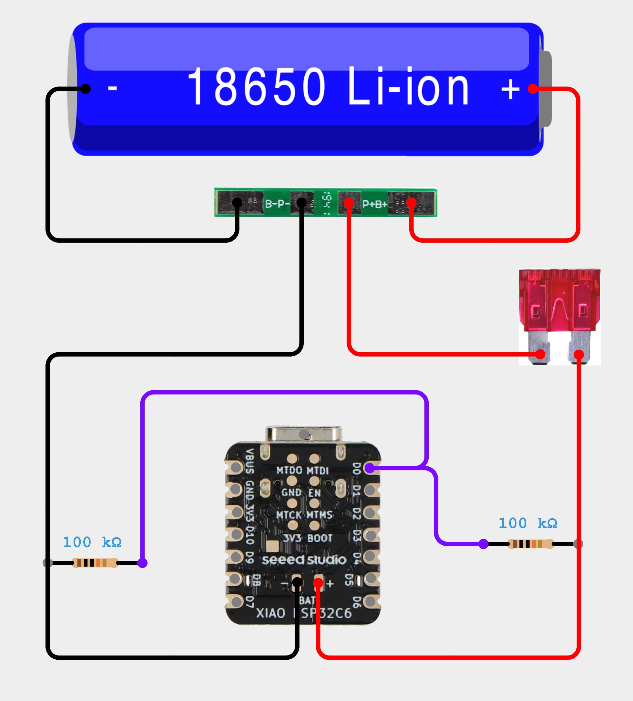

# Parts for a new BirdNETMic build

Our preferred starting point is **XIAO ESP32-C5 + IM73D122 PDM**. Add SD storage
for Recording; Streaming does not need a card. Product links identify components,
not a guarantee that every seller variant or assembly has been tested.

| Part | Purpose and link |
|---|---|
| XIAO ESP32-C5 | Preferred board: PSRAM and built-in battery divider. [Seeed board guide and purchase links](https://wiki.seeedstudio.com/xiao_esp32c5_getting_started/) |
| IM73D122 PDM breakout | Preferred quality-focused microphone; buy a 3.3 V compatible breakout, not a bare microphone package. See [existing project microphone links](../README.md#pdm-microphones) and the wiring below. |
| Adafruit PDM #3492 | Alternative PDM breakout: [product](https://www.adafruit.com/product/3492) |
| Adafruit SPH0645LM4H #3421 | Supported I2S alternative: [product](https://www.adafruit.com/product/3421) |
| Adafruit microSD BFF #5683 | XIAO SD module, soldered headers required, card separate: [product](https://www.adafruit.com/product/5683) |
| microSD card | FAT32; 32 GB used for C5 physical validation. See [capacity and limits](field-recording.md). |
| 1S Li-ion protection board | Example [1S 3 A module](https://www.laskakit.cz/en/ochrana-li-ion-baterie-1s-3a/). Check actual terminal labels and charge/discharge limits; this is protection, not a charger. |
| Protected 18650 pack | 3.7 V nominal / 4.2 V maximum; use matched parallel cells for higher capacity. Prefer a professionally assembled pack. No series pack. |
| Output fuse and holder | Fit in protected positive lead near BMS output. Select to protect the actual wiring; see [Littelfuse selection guide](https://www.littelfuse.com/assetdocs/fuseology-fuse-facts-and-fuse-selection-guide?assetguid=be92b28c-1f63-4f48-a505-55c582b7c1ae). The illustrated 3.5 A value is not a universal recommendation. |
| Two 100 kΩ resistors | Battery divider for C3/S3/C6 only; C5 already includes it. |
| USB data cable, headers, antenna, enclosure | Match the board and connector. Use a suitable outdoor enclosure with an acoustic opening for field work. |

## Connection pictures

The existing pictures show C6; use the printed **D-pin labels** for C5, not C6 GPIO
numbers. Battery measurement differs: C5 does **not** need the external divider.

[Pin-by-pin microphone guide](../README.md#microphones-and-wiring) ·
[SD pins](../README.md#sd-hardware-and-wiring) ·
[Battery and fuse connections](battery-wiring.md)
